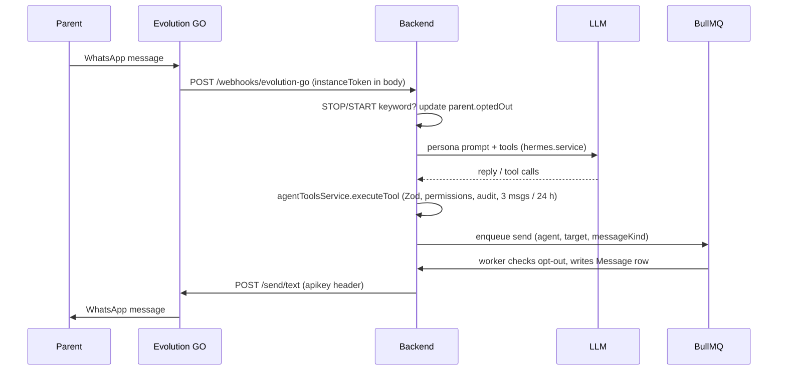

# Architecture

## Components

| Component | Tech | Responsibility |
|---|---|---|
| Backend API | Node 20, Express, TypeScript, Prisma | REST API, auth/RBAC, webhooks, schedulers, AI orchestration, audit log |
| PostgreSQL 16 | | System of record (leads, parents, students, batches, attendance, reports, approvals, messages, call logs, `ai_activity_log`) |
| Redis 7 | | BullMQ queue `whatsapp-messages`, scheduler locks (`lock:*`) and once-per-slot claims (`once:*`). Runs with `noeviction` so locks and jobs are never dropped |
| Evolution GO (+ its own Postgres) | Go gateway | WhatsApp transport. Isolated behind `messaging.adapter.ts` |
| Frontend | React 19, Vite, TanStack Query; nginx in Docker | Staff dashboard. Permissions come from `GET /auth/me` |
| Call agent (optional) | Python 3.12, FastAPI | Voice conversations; a client of the backend `/agent-api`. See [VOICE.md](VOICE.md) |

## Data flow: WhatsApp

Risky actions (discount offers, marking a lead lost, refunds, broadcasts, certificates) do not go through the tool path directly: they create an `Approval` that a human decides, and only then does the executor run (`approval.service.ts`).

## Schedulers

All run inside the API process and are safe with several instances because of Redis locks (see [RUNBOOK.md](RUNBOOK.md)).

| Job | When (IST) | File |
|---|---|---|
| Demo reminders | every 15 min | `reminder.service.ts` |
| Class sessions from batch timetables (`materializeTodaysSessions`) + announcements | every 5 minutes; announcements daily 07:30 plus 5-minute pickup | `class-link.service.ts` |
| Weekly report generation / send | Saturday 10:00 / 17:00 | `weekly-report.service.ts` |
| Teacher reminder rules | tick every 30 s, rule fires on matching weekday + HH:mm | `reminder-rule.service.ts` |

## Authentication surfaces

| Surface | Mechanism |
|---|---|
| Staff API `/api/v1/*` | JWT (`JWT_SECRET`), role-based permissions |
| `/webhooks/evolution-go` | `instanceToken` in body must equal `EVOLUTION_GO_API_KEY` |
| `/webhooks/meta-leads` | HMAC `X-Hub-Signature-256` on raw body, GET handshake with `META_VERIFY_TOKEN` |
| `/api/v1/agent-api/*` | `X-Agent-Key` = `EKALAVYA_AGENT_KEY` (constant-time; 503 if unset) |
| Call agent `/ws/call`, `/api/call/chat` | `CALL_AGENT_API_KEY` bearer / `?token=` |

## Voice integration

The backend owns persona, tool definitions, tool execution and CRM data; the call agent only does speech-to-text, LLM streaming, text-to-speech and call state. Contract:

- `GET /api/v1/agent-api/persona`, `GET /agent-api/tools`, `POST /agent-api/tools/:name`, `POST /agent-api/calls/identify`, `POST /agent-api/call-log`.
- Staff views: `GET /api/v1/calls`, `GET /api/v1/calls/:id` (`leads:manage`); `GET /api/v1/dev/voice/status` (`dev:console`) proxies the agent's `/health`.

Tool calls made during a call run through the same executor as WhatsApp, so validation, permissions, audit and the message guardrail are shared.

## Deployment topology

`docker-compose.yml`: postgres, redis, evolution-postgres, evolution-go, backend (:3001), frontend (:3000), and the opt-in `call-agent` (profile `voice`, :8085 bound to 127.0.0.1). The dev override publishes Postgres, Redis and the Evolution GO Manager on 127.0.0.1 only. There is no TLS terminator in the repo; put a reverse proxy in front of 3000/3001 in production.
