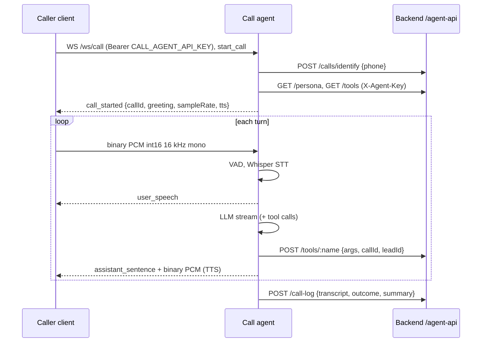

# Voice call agent

Status: optional and opt-in. PRD v1 listed voice as out of scope, so the service ships behind the Compose profile `voice` and nothing else depends on it. The rest of the stack runs without it.

The previous prototype in `backend/model/call agent/` is superseded by the package `backend/call_agent` (importable as `call_agent`). If that package is missing in your checkout, voice is not usable yet.

## Data flow



The backend stores a `CallLog`, an `ai_activity_log` row (`voice_call_completed`) and a `Message` with channel `call`. Staff read them with `GET /api/v1/calls` and `GET /api/v1/calls/:id`. The call log endpoint never sends anything itself.

Run (when the package exists):

```bash
cp backend/call_agent/.env.example backend/call_agent/.env     # fill in keys
docker compose --profile voice up -d --build call-agent
# or locally:
cd backend && python3 -m uvicorn call_agent.server:app --port 8085
curl -s localhost:8085/health
```

## Providers

| Stage | Options | Notes |
|---|---|---|
| STT | Whisper-Tamil-small (local, `WHISPER_MODEL_PATH`) | CPU inference works but is slow; `STT_LANGUAGE=auto` chooses Tamil or English. Weights (~1 GB) are mounted read-only into the container, not baked in |
| LLM | Ollama, OpenAI, OpenRouter (`LLM_PROVIDER`) | Persona and tools are fetched from the backend. When the LLM is unreachable the agent reports an error rather than inventing an answer |
| TTS | `google` (Cloud Text-to-Speech, `GOOGLE_TTS_API_KEY`), `mms` (local Meta MMS), `none` | With `none` or a failed TTS the call continues text-only and `call_started` flags `tts:false`. No fake audio |
| Telephony | Twilio media stream, off by default (`TWILIO_STREAM_ENABLED`, `TWILIO_AUTH_TOKEN`) | Not exercised against a real phone line in this repo |

## Licences and models you must not use

- `backend/model/model.safetensors` is VibeVoice. It is English-only, released for research use only, and its licence restricts telephone use. It is deliberately **not** loaded by the call agent. Do not wire it in for production calls.
- Whisper-Tamil-small: check the licence in `backend/model/whisper-tamil-small/README.md` and the upstream model card before commercial use.
- MMS TTS (CC-BY-NC 4.0 on the original Meta checkpoints) is non-commercial; verify the exact checkpoint you use. Prefer `google` for a commercial deployment, subject to Google's terms.
- Sending audio and transcripts to cloud LLM/TTS providers is a disclosure to those processors; see below.

## Latency expectations

No benchmarks are committed. Rough, unmeasured expectations on a CPU-only machine: Whisper-small takes seconds per utterance; a local 7-27B model on Ollama adds seconds before the first token; cloud TTS adds a few hundred milliseconds per sentence. Expect a turn gap of several seconds unless you use a GPU or cloud STT/LLM. Measure on your hardware with real calls before promising anything to the centre.

## Consent and legal notes (engineering guidance, not legal advice)

Have a lawyer review before calling real parents.

- **AI disclosure**: the first sentence of the greeting served by `/agent-api/persona` must say the caller is speaking to an automated assistant and that the call may be transcribed. Do not remove it.
- **Recording and transcription**: the system stores transcripts (not audio). Tell the caller before storing, give a way to decline (hang up or ask for a human), and do not record audio unless you add explicit consent capture.
- **DPDP Act 2023 (India)**: phone numbers and children's information are personal data. Collect only what the call needs, state the purpose, honour deletion/correction requests, keep retention bounded (define a retention period for `call_logs`), and obtain verifiable parental consent for processing children's data. Transcripts sent to third-party LLM/TTS providers are disclosures to processors and may involve cross-border transfer.
- **Telecom rules**: outbound AI calls for marketing are subject to TRAI telemarketing rules (DND registry, registered headers). This service is designed for inbound or consented calls; verify before using it for outbound.
- **Minimise PII**: `/agent-api/calls/identify` returns only ids, names and lead fields the call needs. Do not put fee amounts or other facts in prompts unless they come from the database.
- **Access**: call logs are readable only with `leads:manage`.

## Known limits

- Fees and demo slots wording come from the backend persona; if no Course/fee data exists the agent must not quote prices.
- No echo cancellation or barge-in tuning beyond what the package implements; verify interruption behaviour with your own client.
- Telephony (Twilio) integration is unverified end to end.
